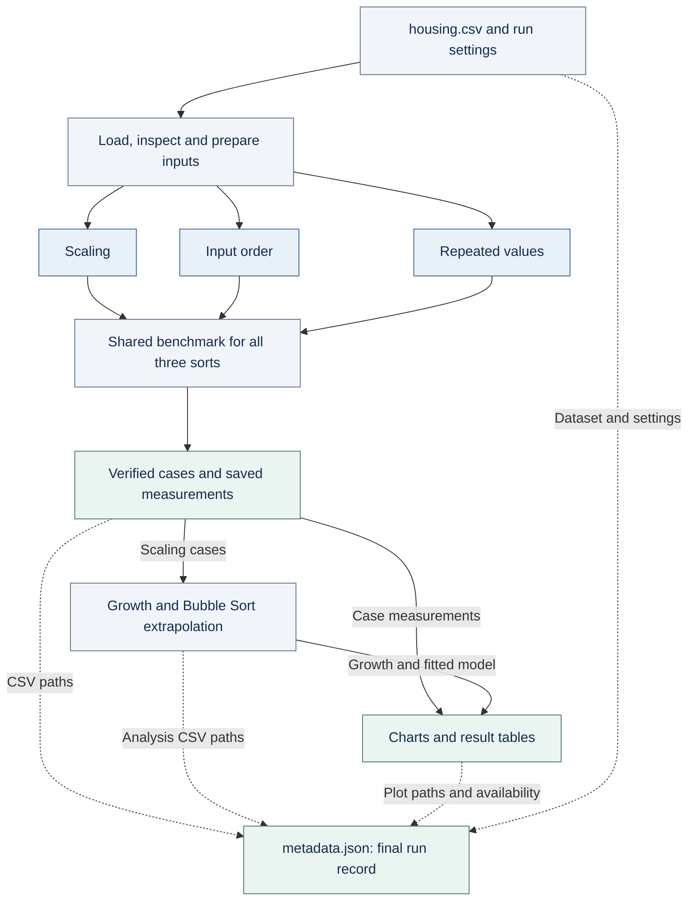

# Sorting Algorithm Analysis

Implements bubble sort, selection sort and merge sort from scratch and compares them on the California Housing dataset: runtime, comparisons and writes across increasing input sizes, different input orders, and columns with different amounts of duplication.

## Project Data Flow

Arrows show the main logical data flows; dotted arrows carry information for the
run record. The three experimental tracks run sequentially, not in parallel.
The shared benchmark times plain sorts; counted runs and correctness checks are
outside timing. Scaling cases feed growth and extrapolation, while case
measurements also feed charts directly.

Metadata is written last after computations succeed. Charts require Matplotlib;
if it is unavailable, metadata records `plots_status` as `missing`. Companion
inspection and duplication-statistics outputs are listed in
[results/README.md](results/README.md).

## Requirements

- Python 3.10 or newer, standard library only.
- `matplotlib` (optional) for the charts. Without it, the run completes and reports that the plots are missing; the charts can then be built from the CSV files in Excel or Google Sheets.

## Dataset

`housing.csv` (California Housing Prices, 20,640 rows) is included in the repository root.
Source: <https://raw.githubusercontent.com/ageron/handson-ml2/master/datasets/housing/housing.csv>

| Column | Used in |
|---|---|
| `median_income` | scaling, input-order and repeated-values experiments |
| `housing_median_age` | repeated-values experiment |
| `median_house_value` | repeated-values experiment |

Rows with a missing or invalid value in any of these columns are excluded and reported.

## Usage

Run from the repository root.

| Command | Description |
|---|---|
| `python main.py check` | Inspect the dataset: rows, missing values and distinct values per column |
| `python main.py scaling` | Scaling experiment only (development) |
| `python main.py order` | Input-order experiment only (development) |
| `python main.py dupes` | Repeated-values experiment only (development) |
| `python main.py analyze` | Growth factors and the bubble sort estimate (quadratic regression) from `cases.csv` |
| `python main.py plot` | Charts from `cases.csv` (requires matplotlib) |
| `python main.py all` | **Official run**: inspection, all experiments, analysis, charts, metadata |
| `python -m unittest discover` | Run all tests |

Options: `--csv PATH` (dataset path), `--out DIR` (output folder; default `results/` for `all`, `results/dev/` otherwise).

Exit codes: `0` success (charts may be missing) · `1` computation failure · `2` input or usage error · `130` interrupted.

## Outputs

`python main.py all` writes the CSV tables, charts and `metadata.json` to `results/`. See [results/README.md](results/README.md) for every file.

## Method

- **Sizes:** 5, 10, 20, 250, 500, 1000, 2000, 4000 (scaling); 2000 (input order and repeated values).
- **Seeds:** sample 42, shuffle 43, nearly sorted 44. Samples are drawn as row indices without replacement; the repeated-values experiment uses the same indices, in the same order, as the input-order experiment for all three columns. All settings are in `sorting_analysis/config.py`.
- **Two versions per algorithm:** a plain version, which is timed, and a counted version with the same loops, which supplies the counts. Counters are never inside the timing.
- **Timing:** `time.perf_counter()`, median of 5 timed batches. Inputs with n ≤ 20 (very small: 5, 10, 20) are sorted 1,000 times per batch; larger inputs once. Loading and input preparation are not timed. Every output is verified against `sorted()` outside the clock: the counted output before the timed run, the timed outputs after the clock stops.
- **Algorithms:** bubble sort as in the lecture (full passes, stop after a pass with no swaps); selection sort swaps at most once per position; merge sort takes the left value on ties.
- **Comparisons:** comparisons between two data values.
- **Writes:** a swap is 2 writes (swaps are also reported); each value placed into a merged list is 1 write, including leftover tails; copies made by slicing, including the initial `values[:]` copy, are not counted.
- **Bubble sort estimate for 20,640 values:** least-squares fit of T(n) = a₀ + a₁·n + a₂·n² to the median times at n = 250, 500, 1000, 2000, 4000, evaluated at n = 20,640.

## Project structure

| Folder | Contents |
|---|---|
| `sorting_analysis/data/` | Dataset loading, inspection, sampling, input orders |
| `sorting_analysis/sorts/` | The three sorting algorithms (plain and counted versions) |
| `sorting_analysis/timing/` | Verified, repeated timing |
| `sorting_analysis/experiments/` | The three experiments and their result records |
| `sorting_analysis/analysis/` | Growth factors and the bubble sort estimate |
| `sorting_analysis/plots/` | Charts |
| `tests/` | End-to-end tests |
| `results/` | Official outputs |

Each feature folder holds its code in `implementation/` and its unit tests in `testing/`. The full design is in [ARCHITECTURE.md](ARCHITECTURE.md); team rules are in [CONTRIBUTING.md](CONTRIBUTING.md).

## Development status

The pipeline in `main.py` is complete. Steps not yet implemented use the mock functions at the top of the file; the **Pipeline steps** block lists every step with the real import in its comment. Replace one line at a time with that import and delete the mock. While any mock is in use, outputs go to `results/dev/` and `metadata.json` is not written. Drafted tests are skipped until they are written.
