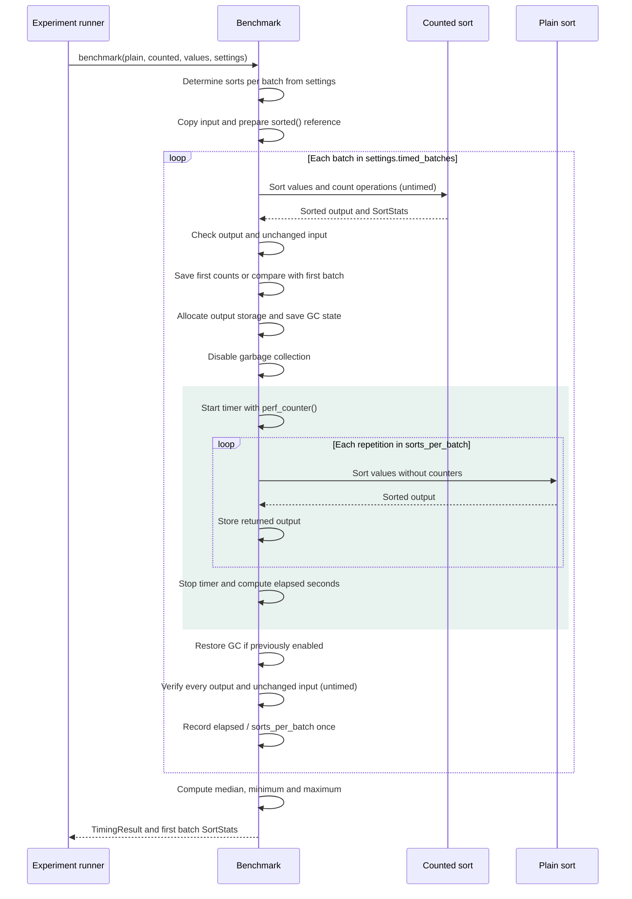

# timing

Measures the runtime of one sort on one input, collects its operation counts, and verifies every output.

| Feature | Purpose |
|---|---|
| `benchmark/` | Timed batches, counts, verification and the median |

## Timing rule

| Input size | Sorts per batch | Batches | Reported |
|---|---|---|---|
| n ≤ 20 (very small: 5, 10, 20) | 1,000 | 5 | median of (batch time ÷ 1,000) |
| n > 20 | 1 | 5 | median of the 5 times |

Only the **plain** sort (no counters) is timed. The timed region (`time.perf_counter()`) contains only its calls and storing their outputs. The **counted** sort runs once per batch outside the clock and supplies the counts. Every output is verified against `sorted()` outside the clock: the counted output before the timed run, the timed outputs after the clock stops. Garbage collection is disabled while timing and restored afterwards.

## Benchmark Execution Sequence

One case measures one sorting algorithm on one prepared input. This diagram
shows the normal successful path; failed output, input-preservation or
count-consistency checks raise `VerificationError`.

- **Outer loop:** every batch includes one untimed counted run and its checks,
  followed by a timed batch of plain sorts. The first batch supplies the reference
  counts; later batches must match them.
- **Inner loop:** the plain sort runs `sorts_per_batch` times on the same unchanged
  input. The shaded timer interval includes the calls, loop overhead and storing
  returned outputs. Copies made inside a plain sort remain part of its timed work.
- **Outside timing:** the reference copy, expected output, counted runs, output
  storage allocation, garbage-collection changes and verification. Garbage
  collection (GC) is Python's automatic cleanup of cyclic objects; its previous
  enabled state is restored after the timer stops.
- **Reported time:** each batch is normalized once as elapsed seconds divided by
  `sorts_per_batch`. The median, minimum and maximum use these seconds-per-sort
  values. The minimum and maximum are observed batch averages, not confidence
  intervals. `timing_runs.csv` already stores normalized times; do not divide them
  again. `median_of` uses the project's plain merge sort outside timing.

The table above shows the current defaults from `config.py`: five batches,
1,000 sorts per batch for inputs of at most 20 values, and one sort per batch
otherwise. The diagram uses settings rather than assuming those defaults in
every run. The same sequence applies to Bubble Sort, Selection Sort and Merge
Sort through the plain/counted pairs in `ALGORITHMS`.

## Interfaces

| Name | Input | Output |
|---|---|---|
| `benchmark(sort_function, counted_sort_function, values, settings)` | plain sort, counted sort, input, settings | `(TimingResult, SortStats)`; `VerificationError` on a wrong output, changing counts or a modified input |
| `TimingResult(batch_seconds, sorts_per_batch, median_seconds, min_seconds, max_seconds)` | seconds per sort per batch, sorts per batch, and their median, min, max | read-only record with a getter per value, filled in once by `benchmark` |
| `repetitions_for(input_size, settings)` | input size, settings | sorts per batch: 1,000 if input_size ≤ 20, else 1 |
| `median_of(values)` | `list[float]` | median, computed with the plain merge sort |
| `VerificationError` | — | raised when verification fails |
